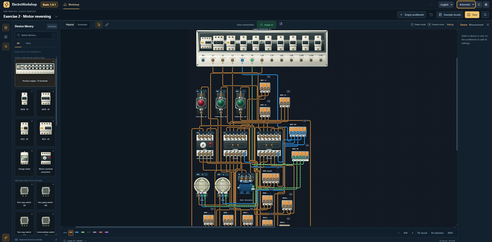
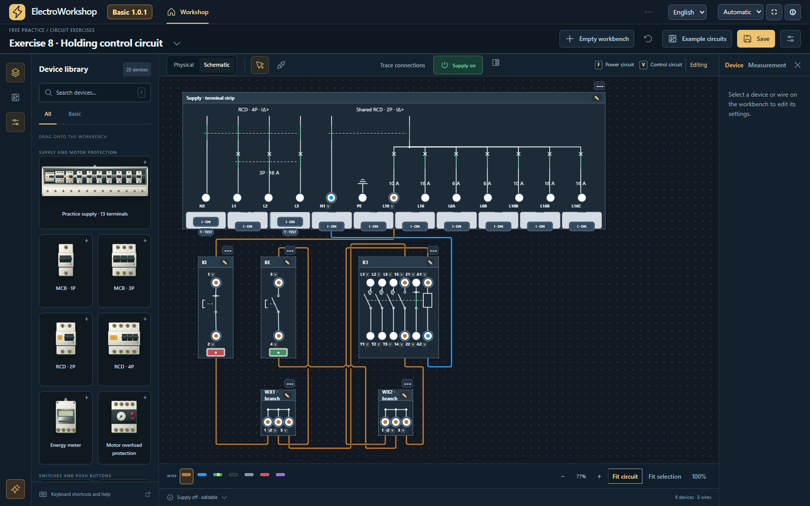
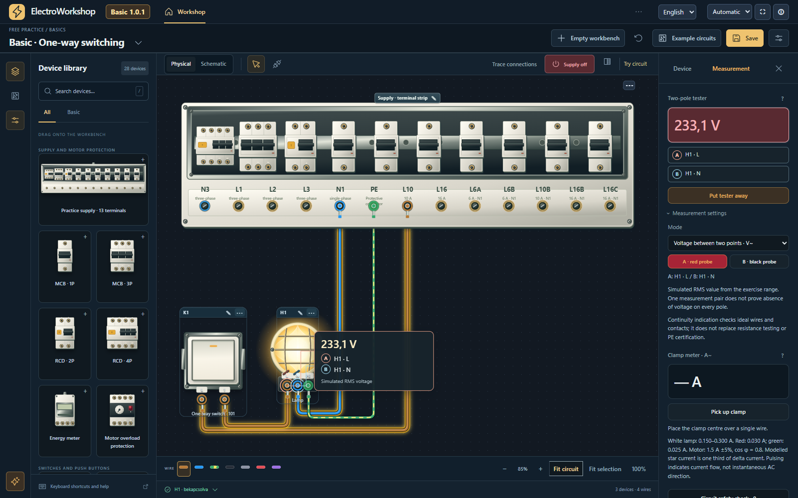
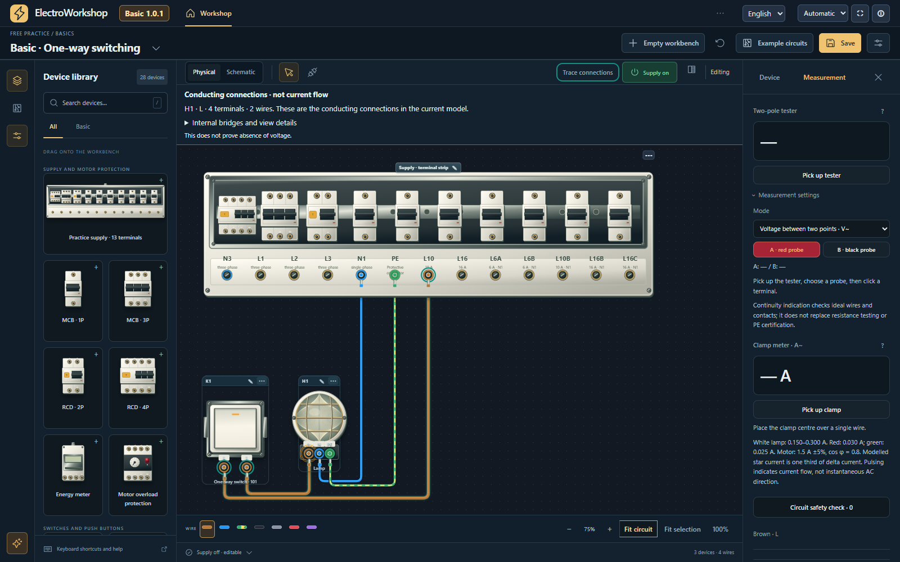

# ElectroWorkshop Basic

A portable Windows electrical workshop for learning conventional wiring,
lighting circuits and motor control. English and Hungarian interfaces.



**Free for private use and non-commercial education. This is a proprietary
application, not an open-source project.** Commercial use requires separate
permission. See [Terms of Use](LICENSE.txt).

## Download and run

1. Open **Releases** on the right of this repository and select the latest release.
2. Download **ElectroWorkshop-Basic-1.0.1-Windows.zip** from its Assets.
3. Extract the complete ZIP and run **ElectroWorkshop.exe**.
4. The workshop opens locally in your default browser. Keep the small launcher
   window open while using it; close it or press Stop when finished.

No Python, Docker, account or internet connection is needed to use the program.
Requires Windows 10/11, the system .NET Framework 4.5 or later, and a current
browser. The packaged application has been tested on Windows with Chrome;
other browser/Windows combinations have not all been independently tested.

Need help locating the EXE? Extract the **Windows ZIP** above, not this
repository's automatic Source code archive. See [Getting started](docs/GETTING-STARTED.md).

GitHub's automatically generated **Source code** archives contain this
repository's documentation, not the application's development source.
Use the named Windows ZIP asset for the actual program.

## Included

- 28 conventional device types in the library.
- Lighting and motor-control examples and practice exercises.
- Physical and schematic views, wiring and simulation.
- Two-pole tester, clamp meter, connection tracing and circuit checks.
- Browser-local autosave and JSON export/import.

The Basic edition does not include MQTT, Home Assistant, smart devices,
3D floorplans or school accounts. Files requiring those features cannot
be opened in this edition. Photographic reference materials from the full
edition are not included.

## Screenshots

These are real captures of the packaged Windows application using example circuits.

| Schematic view | Two-pole voltage measurement |
|---|---|
|  |  |



Connection tracing shows modelled conducting connections, not current flow or
proof of absence of voltage. Click an image to view it at full size.

## Documentation

- [Getting started](docs/GETTING-STARTED.md)
- [External settings and language](docs/SETTINGS.md)
- [Saves, import and updates](docs/SAVES.md)
- [Troubleshooting](docs/TROUBLESHOOTING.md)
- [Frequently asked questions](docs/FAQ.md)
- [Known limitations in 1.0.1](docs/KNOWN-LIMITATIONS.md)
- [Support and feedback](SUPPORT.md)
- [Magyar rövid útmutató](docs/README-HU.txt)

## Language and settings

English is the default on first use. Change language in the header; your
choice is remembered in that browser by default. Circuit storage is shared
between the two languages. Your own device labels are preserved.

Edit **ElectroWorkshop.ini** next to the EXE while the launcher is closed:

```ini
[app]
default_language=en
remember_language=true
open_browser=true
```

`default_language` accepts `en` or `hu`. Set `remember_language=false` to
always start with the configured default instead of a saved language.
Set `open_browser=false` to open the browser manually from the launcher.
Restart the launcher after editing; no repackaging is needed.

## Data and verification

The application listens only on `127.0.0.1:18743`. Your circuits are stored
in your browser, not uploaded. Export important work to JSON before clearing
browser data. Different browsers have separate local storage.

The release includes SHA256 checksums. The executable is not digitally signed.
The development source package is not published; browser-side JavaScript
is technically inspectable. Packing assets into an EXE is not encryption.

Some live status fragments can still appear in Hungarian in the English UI,
and numeric readouts may use a decimal comma. See [Known limitations](docs/KNOWN-LIMITATIONS.md).

This is a teaching simulator, not an installation certification, absence-of-voltage
test or electrical sizing tool. See the in-app help for model limitations.

## Licence and third-party components

Use is subject to [Terms of Use](LICENSE.txt). Third-party icons and fonts
retain their own licences; see [Third-party notices](THIRD-PARTY-NOTICES.txt)
and the `licenses` directory. The application's restrictions do not override
those component licences.

## Feedback

Report reproducible problems in this repository's Issues. Include the program
version, Windows/browser version and reproduction steps. Do not attach
passwords, tokens or personal circuit files containing private information.
