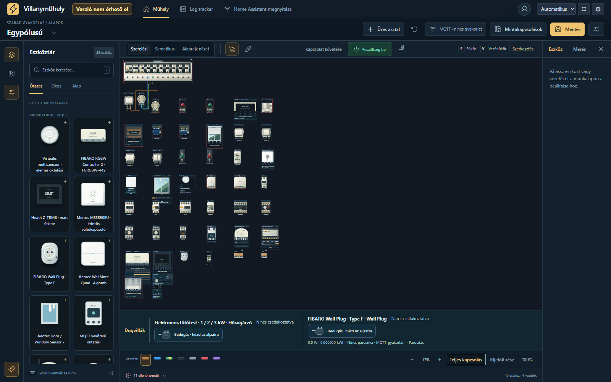
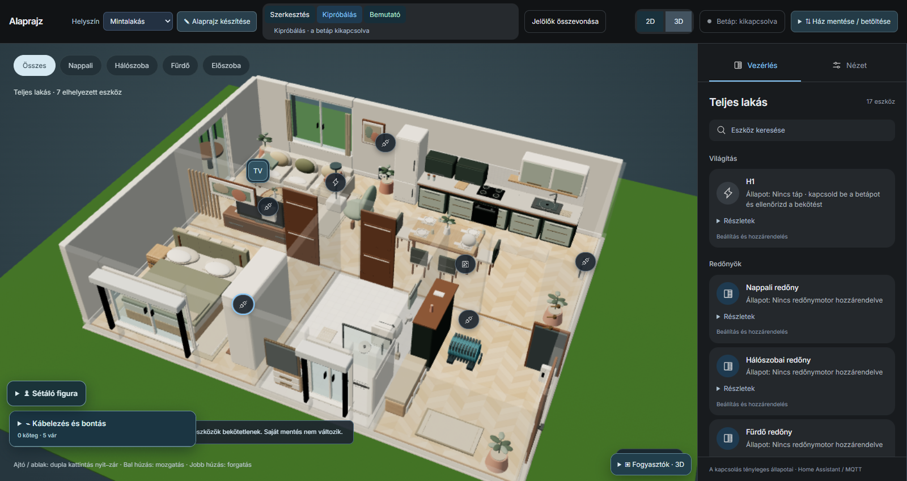
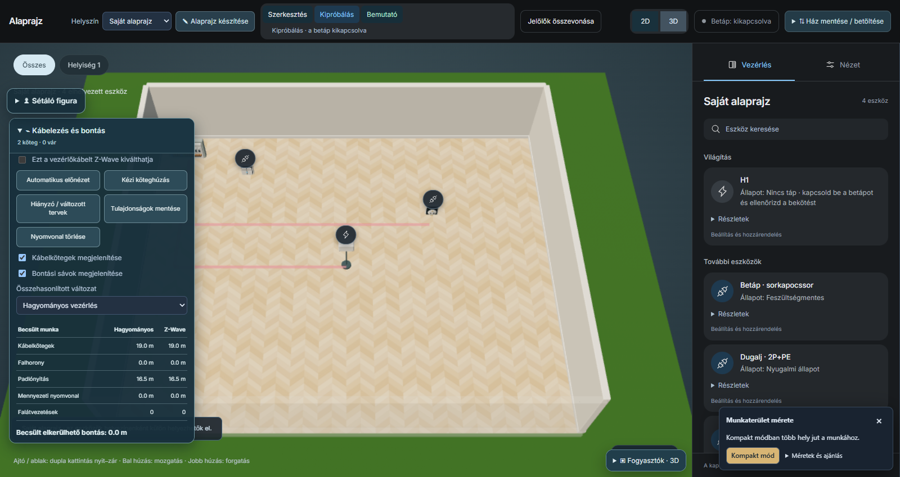
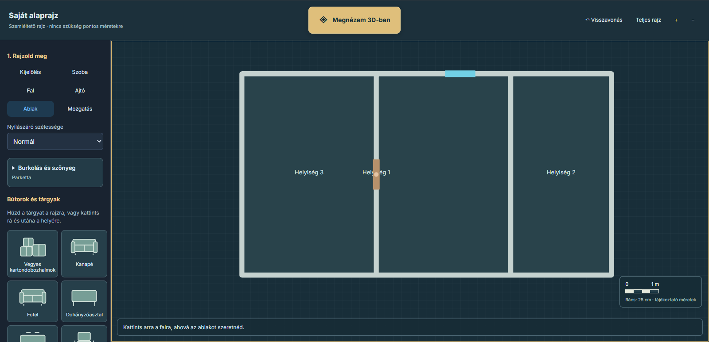

# ElectroWorkshop Basic

A portable Windows electrical workshop for learning conventional wiring,
lighting circuits and motor control. English and Hungarian interfaces.


**Free for private use and non-commercial education. This is a proprietary
application, not an open-source project.** Commercial use requires separate
permission. See [Terms of Use](LICENSE.txt).

## Download and run

1. Open **Releases** on the right of this repository and select the latest release.
2. Download **ElectroWorkshop-Basic-1.0.1-Windows.zip** from its Assets.
3. Extract the complete ZIP and run **ElectroWorkshop.exe**.
4. The workshop opens locally in your default browser. Keep the small launcher
   window open while using it; close it or press Stop when finished.

No Python, Docker, account or internet connection is needed to use the program.
Requires Windows 10/11, the system .NET Framework 4.5 or later, and a current
browser. The packaged application has been tested on Windows with Chrome;
other browser/Windows combinations have not all been independently tested.

Need help locating the EXE? Extract the **Windows ZIP** above, not this
repository's automatic Source code archive. See [Getting started](docs/GETTING-STARTED.md).

GitHub's automatically generated **Source code** archives contain this
repository's documentation, not the application's development source.
Use the named Windows ZIP asset for the actual program.

## Included

- 28 conventional device types in the library.
- Lighting and motor-control examples and practice exercises.
- Physical and schematic views, wiring and simulation.
- Two-pole tester, clamp meter, connection tracing and circuit checks.
- Browser-local autosave and JSON export/import.

The Basic edition does not include MQTT, Home Assistant, smart devices,
3D floorplans or school accounts. Files requiring those features cannot
be opened in this edition. Photographic reference materials from the full
edition are not included.

## Screenshots

These are real captures of the packaged Windows application using example circuits.

| Schematic view | Two-pole voltage measurement |
|---|---|
|  |  |


Connection tracing shows modelled conducting connections, not current flow or
proof of absence of voltage. Click an image to view it at full size.

## Future development: from electrical wiring to a smart home

I’m an electrician student, and ElectroWorkshop is a side project I’m developing in my spare time alongside my studies.

The next direction is to bring together **electrical wiring, smart devices, editable floorplans, 3D cable routing, and Home Assistant integration** in one learning environment.

Development has already started, with promising early results and a working Home Assistant connection in my private laboratory setup.

**These features are not yet available for public testing. They are not included in the downloadable ElectroWorkshop Basic edition.**

The images below are real screenshots captured from the local development version using demonstration circuits and layouts. They show work in progress, currently with Hungarian interface labels.

### Smart devices and their electrical connections



The workshop combines conventional electrical components with models of smart devices. The screenshot shows a distribution board, a wired switch-and-lamp circuit, and a wider selection of components placed on the work surface.

The library on the left includes smart-device models such as sensors, an RGBW controller, a thermostat, a touch switch, and a smart plug.

The purpose is to practise the electrical side of a smart installation as well as its controls: understanding supply connections, switched outputs, loads, and the conditions under which a device can operate.

Further work will connect these wiring exercises more closely with pairing, device states, and Home Assistant control.

*This screenshot shows the component library and wiring workspace. It does not mean every component on the work surface is connected or paired.*

### Understanding the installation in 3D



The 3D view places the installation inside a furnished virtual building. Device markers show where equipment belongs, while the panel on the right displays controls, assignments, and status information for lighting, shutters, and other supported devices.

The aim is to make the relationship between an electrical circuit and its physical location easier to understand. A lamp or shutter becomes part of a room rather than only a component on a wiring canvas.

In this screenshot, the simulated supply is switched off and some devices are not assigned. The interface displays these conditions explicitly.

### Planning cable routes in 3D



This screenshot shows a simple demonstration room with a supply point and placed electrical devices. Two cable routes have been created, and the expanded panel on the left shows the cable-routing tools and estimated quantities.

The development tools support automatic route previews and manual cable-bundle routing. Routes can be displayed together with the associated installation work, such as floor-opening or wall-chasing paths.

The purpose is to explore **how devices are physically connected across a building**, alongside the terminal-to-terminal wiring shown in the workshop.

There is also an experimental comparison between conventional wiring and a scenario where selected control connections can be replaced by wireless control. Wireless control does not remove the need to power mains-powered devices.

*The displayed lengths and installation-work quantities are illustrative estimates for learning and comparison, not a certified installation design or quotation.*

### Creating and editing your own floorplan



The development version includes a floorplan editor, allowing users to create their own layouts instead of relying only on the supplied demonstration buildings.

This screenshot shows a simple three-room layout with an internal doorway and a window. The tools on the left provide room and wall drawing, doors and windows, movement, surface finishes, and furniture placement.

The same layout can be opened in 3D. The intended workflow is to draw and edit a building, arrange its interior, place electrical devices, and explore their wiring and cable routes.

The editor is intended for educational layouts and visual experiments rather than construction documentation.

### A real Home Assistant system in the laboratory

[Home Assistant](https://www.home-assistant.io/) is an open-source home automation platform. It brings devices and sensors together in one place and provides dashboards, controls, and automations.

**ElectroWorkshop’s laboratory integration uses a real Home Assistant installation, not a simulated Home Assistant screen.** The electrical devices inside ElectroWorkshop remain virtual, while Home Assistant is the actual smart-home controller communicating with them.

The private development setup is hosted on my NAS using Docker services:

- **ElectroWorkshop** provides the workshop, simulated devices, and building interface.
- A dedicated **bridge service** translates supported device states and commands between the workshop and MQTT.
- **Mosquitto**, the MQTT message broker, carries messages between the services.
- **Home Assistant**, also installed on the NAS, discovers supported paired devices, receives their states, and provides controls and automation logic.

The communication works in both directions:

**ElectroWorkshop ↔ bridge service ↔ MQTT broker ↔ Home Assistant**

For example, a supported virtual sensor can report its simulated readings to Home Assistant. Home Assistant can then use those readings in an automation and send commands back to a supported virtual actuator in the workshop.

Pairing is part of the laboratory workflow. Supported workshop devices can appear as devices and entities in Home Assistant, and a dedicated virtual workshop hub allows pairing to be initiated from Home Assistant.

This makes it possible to practise with an actual smart-home platform while using simulated electrical equipment. It does not require the virtual devices to contain physical Zigbee or Z-Wave radios: this laboratory connection uses [MQTT](https://www.home-assistant.io/integrations/mqtt/).

*The screenshots above were captured locally to demonstrate the interface. They do not show an active connection to the NAS or a live Home Assistant dashboard.*

### What is available now?

The public Windows download contains **ElectroWorkshop Basic**, the conventional electrical workshop.

The smart-device integration, Home Assistant laboratory connection, editable floorplans, 3D building view, and cable-routing tools belong to a separate development version. Work on these features is ongoing, and there is no announced public testing or release date.

The long-term goal is a connected learning workflow: **draw a building, wire its devices, explore cable routes in 3D, and experiment with smart-home control through a real Home Assistant system.**

## Documentation

- [Getting started](docs/GETTING-STARTED.md)
- [External settings and language](docs/SETTINGS.md)
- [Saves, import and updates](docs/SAVES.md)
- [Troubleshooting](docs/TROUBLESHOOTING.md)
- [Frequently asked questions](docs/FAQ.md)
- [Known limitations in 1.0.1](docs/KNOWN-LIMITATIONS.md)
- [Support and feedback](SUPPORT.md)
- [Magyar rövid útmutató](docs/README-HU.txt)

## Language and settings

English is the default on first use. Change language in the header; your
choice is remembered in that browser by default. Circuit storage is shared
between the two languages. Your own device labels are preserved.

Edit **ElectroWorkshop.ini** next to the EXE while the launcher is closed:

```ini
[app]
default_language=en
remember_language=true
open_browser=true
```

`default_language` accepts `en` or `hu`. Set `remember_language=false` to
always start with the configured default instead of a saved language.
Set `open_browser=false` to open the browser manually from the launcher.
Restart the launcher after editing; no repackaging is needed.

## Data and verification

The application listens only on `127.0.0.1:18743`. Your circuits are stored
in your browser, not uploaded. Export important work to JSON before clearing
browser data. Different browsers have separate local storage.

The release includes SHA256 checksums. The executable is not digitally signed.
The development source package is not published; browser-side JavaScript
is technically inspectable. Packing assets into an EXE is not encryption.

Some live status fragments can still appear in Hungarian in the English UI,
and numeric readouts may use a decimal comma. See [Known limitations](docs/KNOWN-LIMITATIONS.md).

This is a teaching simulator, not an installation certification, absence-of-voltage
test or electrical sizing tool. See the in-app help for model limitations.

## Licence and third-party components

Use is subject to [Terms of Use](LICENSE.txt). Third-party icons and fonts
retain their own licences; see [Third-party notices](THIRD-PARTY-NOTICES.txt)
and the `licenses` directory. The application's restrictions do not override
those component licences.

## Feedback

Report reproducible problems in this repository's Issues. Include the program
version, Windows/browser version and reproduction steps. Do not attach
passwords, tokens or personal circuit files containing private information.

## Support ElectroWorkshop ☕⚡

If ElectroWorkshop helps you learn or practise electrical wiring, you can support its development:

- ⚡ **[Become a supporter on Patreon](https://www.patreon.com/vojakimate)** — help fund improvements and future smart-home features, including Home Assistant integration.
- ☕ **[Buy me a coffee via Revolut](https://revolut.me/mtuql2w)** — send a one-time contribution.

Support is entirely optional. **ElectroWorkshop Basic remains free for private use and non-commercial education.** Contributions do not change the software licence or guarantee specific features or release dates.

Thank you for supporting the project!
